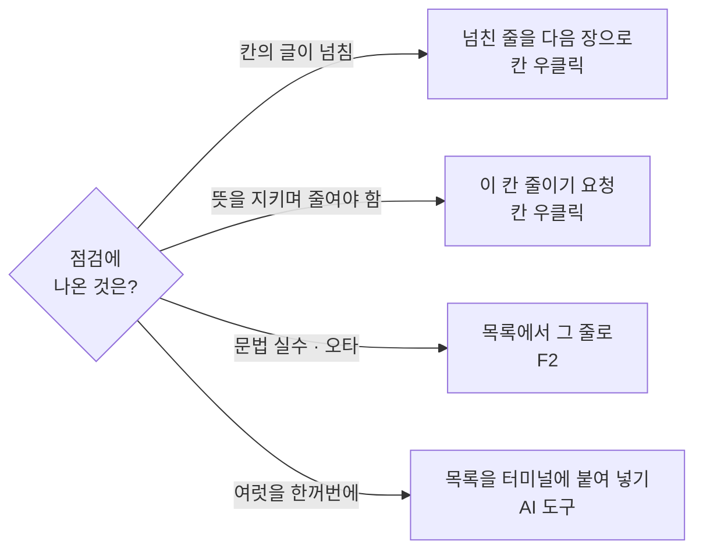

# 발표와 점검

> Lectern 슬라이드는 md 문서처럼 지금 창에서 열린다. 상태줄의 도구로 발표하고, 숨은 줄을 보고, 넘치거나 잘못 쓴 곳을 점검한다.

## 어디서 보나

| 보는 곳 | 여는 법 | 스타일 | 메모 |
|---|---|---|---|
| 지금 창의 문서 칸 | 사이드바에서 누르기 — md 문서와 같은 탭 규칙 | 메인 창의 스타일 | 슬라이드 도구는 상태줄에 |
| 슬라이드 창 | 사이드바 우클릭 **새 창에서 열기** · 문서 탭 우클릭 **새 창으로 옮기기** (**Ctrl+Shift+N**) | 메인 창과 따로 고른다 — 기본은 **발표** | 이미 열려 있으면 그 창이 앞으로 온다. 터미널은 메인 창의 것 |

새 창은 고를 때만 열린다. 화면 스타일을 바꿔도 pptx 스타일은 바뀌지 않는다.

## 상태줄의 슬라이드 도구

| 버튼 | 하는 일 | 자세히 |
|---|---|---|
| **발표** | 지금 보는 장부터 창 전체에 한 장씩 (**Shift+F5**) | [발표](#발표) |
| **문서로 보기** | 칸을 풀어 보통 문서처럼 이어서 본다 | — |
| **구조 보기** | 칸 머리 줄과 지시어 · 노트 줄을 꼬리표로 | [구조 보기](#구조-보기) |
| **점검** (점검 3장처럼) | 넘치거나 잘못 쓴 곳의 목록. 고칠 것이 없고 글만 줄였으면 **줄인 글** (줄인 글 2장처럼) | [점검](#점검) |
| **pptx 로 전환** · **html 로 전환** | 문서 옆에 pptx · 발표 html 파일 | [pptx 와 html 발표](6.4-pptx와-html-발표.md) |

## 발표

| 하려는 일 | 마우스 | 키 |
|---|---|---|
| 발표 시작 — 지금 보는 장부터 | 상태줄 **발표** · 슬라이드의 **▶** | **Shift+F5** |
| 다음 장 | 누르기 · 휠 아래로 | **→** · **Space** · **PageDown** · **↓** |
| 이전 장 | 휠 위로 | **←** · **PageUp** · **↑** |
| 첫 장 · 마지막 장 | — | **Home** · **End** |
| 발표자 노트 보이기 · 감추기 | — | **N** |
| 전체 화면 켜기 · 끄기 | — | **F** |
| 발표 끝내기 | 막대의 **✕** | **Esc** |

숨긴 장(`<!-- hidden: true -->`)은 발표에서 빠진다. 발표 중에는 체크 칸을 눌러도 원문이 바뀌지 않는다.

## 구조 보기

| 하려는 일 | 방법 |
|---|---|
| 숨은 줄 보기 | 상태줄 **구조 보기** — 칸 머리 줄과 지시어 · 노트 줄이 꼬리표로 나온다 |
| 그 줄 고치기 | 꼬리표를 누르고 **F2** — 칸 꾸밈이나 배치를 이렇게 바꾼다 |

## 점검

넘치거나 잘못 쓴 곳이 있으면 상태줄에 **점검** 이 나온다. 누르면 목록이 나오고, 고르면 그 줄로 간다. 오른쪽 목차에도 점검할 장이 표시된다.

| 점검하는 것 | 무엇 |
|---|---|
| 넘침 | 바닥 크기까지 줄여도 넘치는 칸 — 잘리고 빨간 점선이 붙는다 ([넘칠 때](#넘칠-때)) |
| 문법 실수 | 칸 이름, 빠뜨린 `:::`, 지시어와 낱말의 오타, 잘못된 격자, 닫지 않은 주석 · 코드 블록, `---` 바로 위의 글, 풀리지 않은 `**` |
| 화면에서 잰 것 | 바탕과 비슷한 글자, 옆으로 잘린 코드 · 표, 없는 그림, 그리지 못한 차트 — 사진 위의 글은 재지 못하니 눈으로 본다 |
| 작은 글자 | 표 12pt · 본문 14pt 아래 (`reading: true` 면 표 10pt · 본문 12pt). 차트의 글자는 장 위에 보이는 크기로 재어 표의 기준으로 본다 |

| 목록에서 | 하는 일 |
|---|---|
| 항목 고르기 | 그 줄로 간다 |
| **목록을 터미널에 붙여 넣기** | 고쳐 달라는 요청 글이 터미널의 AI 도구(Claude Code 등)에 들어간다 (**Enter** 는 누르지 않음) |
| **목록 복사** | 목록을 복사한다 |

## 넘칠 때

칸의 글이 넘치면 Lectern 이 아래 차례로 맞춘다. PowerPoint 의 '넘치면 글자 줄이기'와 같다.

| 차례 | 하는 일 |
|---|---|
| 1 | 그림 · 다이어그램을 남은 높이에 맞춰 줄인다. 차트는 줄이지 않고 남은 자리에 맞춰 다시 그린다 — 범례 · 축 글자가 작아지지 않는다 |
| 2 | 그래도 넘치면 그 칸의 글을 줄인다. 본문 14pt · 표와 코드 12pt 까지 (`reading: true` 면 12pt · 10pt). 장 제목은 줄지 않는다 |
| 3 | 같은 줄에 나란한 같은 꾸밈의 칸(카드 둘 등)은 같은 크기로 줄인다 |
| 4 | 줄여도 넓은 코드는 줄을 접는다 |
| 5 | 그래도 넘치면 잘리고 빨간 점선이 붙는다 — 점검에 나온다 |

글을 줄인 장은 틀에 표시가 없다. 점검 목록의 **넘쳐서 글을 줄인 곳** 에 나오고, 터미널로 보내는 목록에는 들지 않는다. 글자를 원래 크기로 보이게 하려면 그 칸의 글을 줄이거나 장을 나눈다.

## PDF 와 인쇄

| 하려는 일 | 방법 | 결과 |
|---|---|---|
| PDF | 본문 여백 우클릭 **PDF로 저장…** | 슬라이드 크기의 쪽에 한 장씩, 화면과 같은 색 — 숨긴 장과 발표자 노트는 빠진다 |
| 인쇄 | 본문 여백 우클릭 **인쇄…** | 한 장에 한 쪽 |

## 관련

| 문서 | 무엇 |
|---|---|
| [슬라이드 쓰기](5.1-슬라이드-쓰기.md) | 칸 · 배치 · 글자 크기 |
| [따로 창](2.7-따로-창.md) | 슬라이드 창 같은 독립창 |
| [인쇄와 PDF](6.1-인쇄와-PDF.md) | 내보내기 창 |
| [pptx 와 html 발표](6.4-pptx와-html-발표.md) | 상태줄의 두 전환 |
