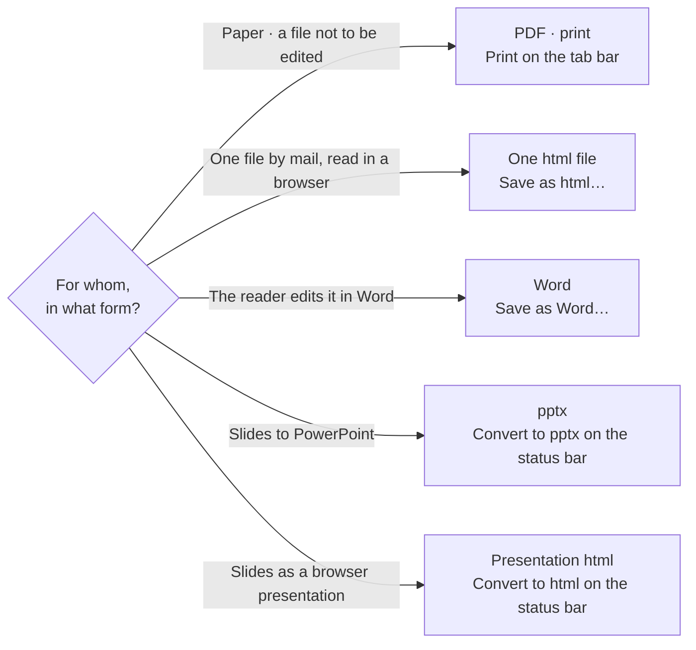

# Export

> md documents go out as PDF, print, html or Word; Lectern slides as PDF, pptx or presentation html. Lectern writes one file, only when you choose to save.

| Format | From | Where to open it | Result |
|---|---|---|---|
| PDF · print | md documents · Lectern slides | **Print** on the tab bar · right-click the body margin → **Save as PDF…** · **Print…** | The A4 report layout or a page layout — slides come out one per page |
| One html file | md documents | Right-click → **Save as html…** | One html file with the images · charts inside |
| Word | md documents | Right-click → **Save as Word…** | A docx to keep editing — it borrows a Word template |
| pptx | Lectern slides | **Convert to pptx** on the status bar | A new pptx next to the document |
| Presentation html | Lectern slides | **Convert to html** on the status bar | An impress.js presentation html next to the document |

PDF, html and Word are made in the same **Export** window by switching the format, and you pick where to save in the save dialog. pptx and presentation html never overwrite a file of the same name; they are made with a new name.

## Documents in this chapter

<!-- 하위 문서 -->
