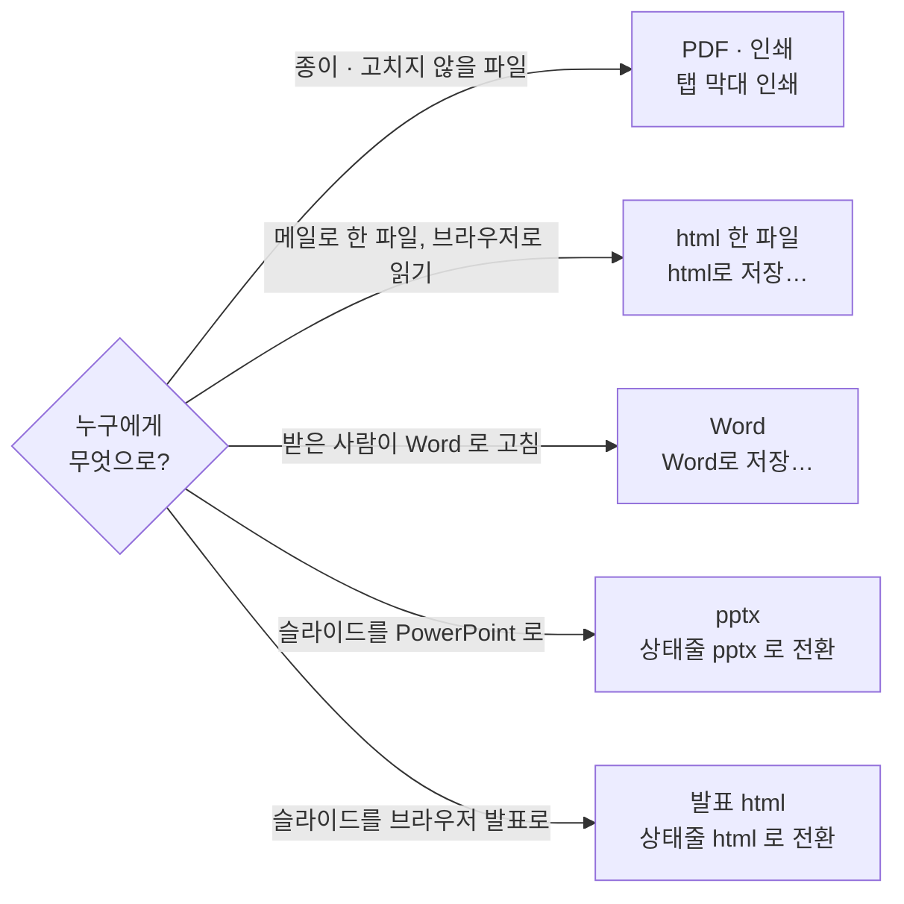

# 내보내기

> md 문서는 PDF·인쇄·html·Word 로, Lectern 슬라이드는 PDF·pptx·발표 html 로 낸다. 파일은 사용자가 저장을 고를 때만 하나 쓴다.

| 형식 | 무엇에서 | 여는 곳 | 결과 |
|---|---|---|---|
| PDF · 인쇄 | md 문서 · Lectern 슬라이드 | 탭 막대 **인쇄** · 본문 여백 우클릭 **PDF로 저장…** · **인쇄…** | A4 보고서 양식이나 지면 틀 — 슬라이드는 한 장에 한 쪽 |
| html 한 파일 | md 문서 | 우클릭 **html로 저장…** | 그림 · 차트가 안에 든 html 하나 |
| Word | md 문서 | 우클릭 **Word로 저장…** | 고쳐 쓸 docx — Word 양식을 빌린다 |
| pptx | Lectern 슬라이드 | 상태줄 **pptx 로 전환** | 문서 옆에 새 pptx |
| 발표 html | Lectern 슬라이드 | 상태줄 **html 로 전환** | 문서 옆에 impress.js 발표 html |

PDF·html·Word 는 같은 **내보내기** 창에서 형식만 바꿔 고르고, 저장할 곳은 저장 대화상자에서 고른다. pptx 와 발표 html 은 같은 이름이 있으면 덮어쓰지 않고 새 이름으로 만든다.

## 이 장의 문서

<!-- 하위 문서 -->
