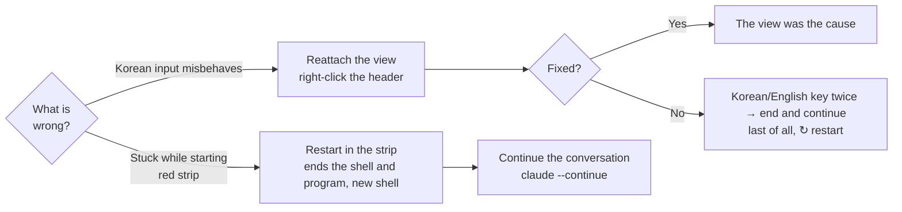

# Terminal

> Open the project folder's PowerShell beside the document, up to five per project. All terminals gathers the terminals of several projects on one screen.

The terminal is ordinary Windows PowerShell. It starts in the current tab's project folder, and each project tab has its own shell. Commands you type there run as they are.

## At a glance

| What to do | Mouse | Keys |
|---|---|---|
| Open · hide the terminal | **Terminal** on the tab bar · **×** at the right end of the header | **Ctrl+\`** (the key left of 1) |
| Add a terminal | **+** in the header (up to 5 per project) | — |
| Pick a terminal | [1 PowerShell] [2 PowerShell] in the header · click a stacked pane | **F6** · **Shift+F6** |
| End a terminal | **×** on its tab · middle-click | — |
| Restart the shell | **↻** in the header | — |
| Reattach only the view | Right-click the header, a terminal tab or a stacked pane's header → **Reattach terminal N view** | **Ctrl+Shift+P** 'Reattach the terminal view' |
| Copy · paste | Drag to select text, then right-click | **Ctrl+C** · **Ctrl+V** |
| Stop the running command | — | **Ctrl+C** with no text selected |
| Change the width · height | Drag the border (double-click for the default width) | — |
| Move to the right · below | The position button in the header | — |
| Open the terminal settings | Header right-click **Terminal settings…** | — |
| All terminals | **All terminals** in the toolbar | **Ctrl+Shift+\`** |

## Hiding · ending · restarting

| Action | How | Shell and programs | Afterwards |
|---|---|---|---|
| Hide | **×** at the right end of the header · **Ctrl+\`** | Keep running | Opening it again continues where you left off |
| End | **×** on its tab · middle-click | That shell and the programs started from it end — if a program is running, Lectern asks first | If it was the last terminal, the panel hides; opening it again starts a new shell as terminal 1 |
| Restart | **↻** | Starts the shell anew | — |
| Reattach the view | Right-click **Reattach terminal N view** | Nothing ends — only the view is rebuilt and attached to the same shell, and the recent output (about 520,000 characters) comes back | — |
| The window reloads (changing the language and so on) | — | The running terminals carry on as they are | — |
| Close a project tab | **×** on the tab | Its shell ends — if a program is running, Lectern asks first | — |
| Close Lectern | — | All shells end together | The screen history is gone too |

## Several terminals

Open up to five terminals in one project — for example, terminal 1 for the AI tool and terminal 2 for other commands. How they look depends on where the terminal is.

| Position | Look | Picking |
|---|---|---|
| Right of the document | With two or more, they stack top to bottom, all visible. Terminal 1 is at the bottom and higher numbers go above. Each pane has a header with its number · shell name · × | Click a pane — ↻ applies to that terminal |
| Below the document | Tabs [1 PowerShell] [2 PowerShell] in the header | Click a tab |

| Case | What happens |
|---|---|
| Height of stacked panes | Split evenly. Drag the border between panes to change it; double-click it, or add or close a terminal, and they are even again |
| A narrow panel | Tabs not picked get shorter names, and × appears when you point at them |
| Tools that use the whole screen (OpenCode and others) | In a short stacked pane only the lower part shows — drag the border to make it taller, or put the terminal below the document (tabs) |

## Focus and keys

**F6** moves the focus one place at a time in the order **document → terminal 1 → 2 → 3 … → sidebar → document**, and **Shift+F6** goes the other way. It works inside the terminal too.

| Situation | What happens |
|---|---|
| The terminal is closed | **F6** opens it and goes to terminal 1. It passes through all of them in number order, stacked or as tabs |
| Going to the sidebar | Where you last were in it (the search box · the selected row). If the sidebar is hidden (**Ctrl+B**), it is skipped |
| Coming back to the document | Where you were — the editor in edit mode, the same spot in the box while line editing (the box stays as it is, unsaved) |
| After clicking the contents · toolbar | Focus left there counts as the document |
| Where keys go | Shown by an accent line — the header for the terminal, the document tab row for the document |
| Keys inside the terminal | Go to the shell. Use app keys such as **Ctrl+P** · **Ctrl+F** · **F1** after clicking the body (**Ctrl+Tab** goes to the next tab even inside the terminal) |
| **Tab** in a document | Never leaves the document — use **F6** to get to the terminal · sidebar |
| View-only projects (the samples) · separate windows | There is no terminal, so focus moves only between the document and the sidebar |

## When something is wrong

| Stuck program | Details |
|---|---|
| When it happens | When security software on a company PC (DRM and the like) blocks programs from starting — Claude Code calls git and then stops taking any input |
| What you see | After about 10 seconds, a red strip under the terminal header and **↻** highlighted. For a terminal in a tab you are not looking at, a notice appears once |
| Ending it | Often neither **Ctrl+C** nor Task Manager ends it — press **Restart** in the strip |
| Carrying on | In the new shell, `claude --continue` · `codex resume --last` · `agy --continue` · `opencode --continue` |

## All terminals

Gathers the terminals of the open projects on one screen in a grid. See the AI tools running in several projects at a glance.

| What to do | How |
|---|---|
| Open · close | **All terminals** in the toolbar · **Ctrl+Shift+\`** |
| See the state | 'Running' · 'Idle' in the pane header. A pane stuck while starting shows 'Stuck' in red — use that pane's **↻** |
| Pick the terminal a pane shows | For a project with several terminals, the numbers (1 2 3) in the pane header |
| Next pane | **Ctrl+Tab** inside a pane |
| Enlarge one pane | Double-click the pane header |
| Go to that project | The pane's **→** — opens the terminal on the right |
| Back to the documents | Click a project tab |

## Position and settings

In a wide window the terminal opens to the right of the document; in a tall one (a portrait monitor, a window snapped to half the screen) it opens below the document. Drag the border to change the width on the right or the height below. Switching between right and below with the position button in the header keeps it in that position.

| Setting | What it does |
|---|---|
| Terminal position | Auto (below the document when the window is tall) · Right · Below — sets a position fixed with the position button back to 'Auto' |
| Match terminal colors to style | On, the terminal follows the document style; off, it is always dark |
| Terminal text size | 10–24 (default 14) — with the − · + · Default size buttons or a number. Applies at once to open terminals and All terminals |
| `terminal_shell` (settings file) | The shell's full path (for example PowerShell 7). Leave it empty for Windows PowerShell |

The terminal works on Windows 10 (1809) or later.

## Related

| Document | What |
|---|---|
| [Sending and requests](7.2-sending-and-requests.en.md) | Putting locations · text into the terminal · which terminal it goes to |
| [Working with AI tools](7-working-with-ai-tools.en.md) | Commands and files that differ by tool |
| [Settings](9-settings.en.md) | The Terminal section of Settings |
