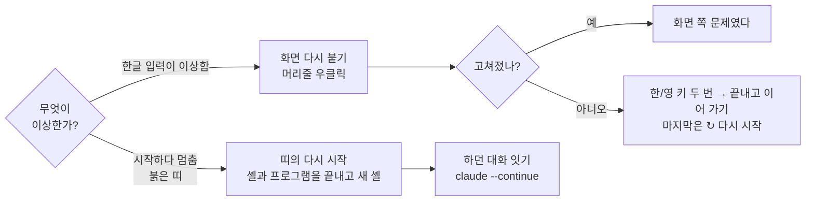

# 터미널

> 본문 옆에 프로젝트 폴더의 PowerShell 을 열고, 프로젝트마다 다섯 개까지 둔다. 터미널 모음은 여러 프로젝트의 터미널을 한 화면에 모은다.

터미널은 보통의 Windows PowerShell 이다. 지금 탭의 프로젝트 폴더에서 시작하고, 프로젝트 탭마다 셸이 따로다. 거기서 친 명령은 그대로 실행된다.

## 한눈에

| 하려는 일 | 마우스 | 키 |
|---|---|---|
| 터미널 열기 · 감추기 | 탭 막대의 **터미널** · 머리줄 오른쪽 끝 **×** | **Ctrl+\`** (숫자 1 왼쪽 키) |
| 터미널 더하기 | 머리줄의 **+** (프로젝트마다 5개까지) | — |
| 터미널 고르기 | 머리줄의 [1 PowerShell] [2 PowerShell] · 쌓은 칸 누르기 | **F6** · **Shift+F6** |
| 터미널 끝내기 | 그 탭의 **×** · 가운데 버튼 | — |
| 셸 다시 시작 | 머리줄의 **↻** | — |
| 화면만 다시 붙기 | 머리줄·터미널 탭·쌓은 칸의 머리줄 우클릭 **N번 터미널 화면 다시 붙기** | **Ctrl+Shift+P** '터미널 화면 다시 붙기' |
| 복사 · 붙여 넣기 | 글을 끌어 고른 뒤 우클릭 | **Ctrl+C** · **Ctrl+V** |
| 실행 중인 명령 멈추기 | — | 고른 글이 없을 때 **Ctrl+C** |
| 폭 · 높이 바꾸기 | 경계 끌기 (두 번 누르면 기본 폭) | — |
| 오른쪽 · 아래로 옮기기 | 머리줄의 자리 버튼 | — |
| 터미널 설정 열기 | 머리줄 우클릭 **터미널 설정…** | — |
| 터미널 모음 | 툴바의 **터미널 모음** | **Ctrl+Shift+\`** |

## 감추기 · 끝내기 · 다시 시작

| 하는 것 | 방법 | 셸과 프로그램 | 그다음 |
|---|---|---|---|
| 감추기 | 머리줄 오른쪽 끝 **×** · **Ctrl+\`** | 계속 돈다 | 다시 열면 이어진다 |
| 끝내기 | 그 탭의 **×** · 가운데 버튼 | 그 셸과 거기서 띄운 프로그램이 끝난다 — 프로그램이 돌고 있으면 먼저 묻는다 | 마지막 터미널이면 패널이 감춰지고, 다시 열 때 새 셸로 1번 |
| 다시 시작 | **↻** | 셸을 새로 시작한다 | — |
| 화면 다시 붙기 | 우클릭 **N번 터미널 화면 다시 붙기** | 끝나지 않는다 — 화면만 새로 만들어 같은 셸에 붙고 최근 출력(약 52만 글자)을 다시 받는다 | — |
| 화면을 다시 불러옴 (언어 바꾸기 등) | — | 돌던 터미널들이 그대로 이어진다 | — |
| 프로젝트 탭 닫기 | 탭의 **×** | 그 셸이 끝난다 — 프로그램이 돌고 있으면 먼저 묻는다 | — |
| Lectern 닫기 | — | 모든 셸이 함께 끝난다 | 화면 기록도 사라진다 |

## 여러 터미널

한 프로젝트에 터미널을 다섯 개까지 연다 — 예를 들어 1번은 AI 도구, 2번은 다른 명령. 보이는 모양은 터미널의 자리를 따른다.

| 자리 | 보이는 모양 | 고르기 |
|---|---|---|
| 문서 오른쪽 | 둘 이상이면 위아래로 쌓여 모두 보인다. 1번이 맨 아래이고 번호가 클수록 위. 칸마다 머리줄에 번호·셸 이름·× | 칸을 누른다 — ↻ 는 그 터미널에 |
| 문서 아래 | 머리줄의 탭 [1 PowerShell] [2 PowerShell] | 탭을 누른다 |

| 경우 | 어떻게 되나 |
|---|---|
| 쌓은 칸의 높이 | 똑같이 나뉜다. 칸 사이 경계를 끌어 바꾸고, 두 번 누르거나 터미널을 더하고 닫으면 다시 똑같이 |
| 패널이 좁으면 | 고르지 않은 탭은 이름이 줄고, × 는 마우스를 올릴 때 나온다 |
| 화면 전체를 쓰는 도구 (OpenCode 등) | 쌓은 칸이 좁으면 아래쪽만 보인다 — 경계를 끌어 키우거나 터미널을 문서 아래(탭)에 둔다 |

## 초점과 키

**F6** 은 초점을 **문서 → 터미널 1 → 2 → 3 … → 사이드바 → 문서** 차례로 한 곳씩 옮기고, **Shift+F6** 은 거꾸로 옮긴다. 터미널 안에서도 된다.

| 상황 | 동작 |
|---|---|
| 터미널이 닫혀 있으면 | **F6** 이 열면서 1번으로 간다. 쌓여 있든 탭이든 번호 차례로 모두 거친다 |
| 사이드바로 가면 | 그 안에서 마지막에 있던 곳(검색 칸 · 고른 행). 사이드바를 감췄으면(**Ctrl+B**) 건너뛴다 |
| 문서로 돌아오면 | 보던 자리 — 편집 중이면 편집기, 한 줄 편집 중이면 그 칸의 그 자리 (칸은 저장하지 않고 그대로) |
| 목차·툴바를 누른 뒤 | 남은 초점은 문서로 본다 |
| 키가 가는 쪽 | 강조색 줄로 보인다 — 터미널은 머리줄, 문서는 문서 탭 줄 |
| 터미널 안의 키 | 셸로 간다. **Ctrl+P** · **Ctrl+F** · **F1** 같은 앱 키는 본문을 누른 뒤에 쓴다 (**Ctrl+Tab** 은 터미널 안에서도 다음 탭) |
| 문서 안의 **Tab** | 문서를 떠나지 않는다 — 터미널·사이드바로는 **F6** |
| 보기만 하는 프로젝트(예제) · 독립창 | 터미널이 없어 문서와 사이드바만 오간다 |

## 이상할 때

| 멈춘 프로그램 | 내용 |
|---|---|
| 생기는 때 | 회사 PC 의 보안 프로그램(DRM 등)이 프로그램 실행을 막을 때 — Claude Code 가 git 을 부르다 아무 입력도 받지 않게 된다 |
| 보이는 것 | 10초쯤 뒤 터미널 머리줄 아래에 붉은 띠, **↻** 강조. 보이지 않는 탭의 터미널이면 알림이 한 번 뜬다 |
| 끝내기 | **Ctrl+C** 로도 작업 관리자로도 끝나지 않을 때가 많다 — 띠의 **다시 시작**을 누른다 |
| 이어 가기 | 새 셸에서 `claude --continue` · `codex resume --last` · `agy --continue` · `opencode --continue` |

## 터미널 모음

열린 프로젝트들의 터미널을 한 화면에 격자로 모은다. 여러 프로젝트에서 돌린 AI 도구를 한눈에 본다.

| 하려는 일 | 방법 |
|---|---|
| 열기 · 닫기 | 툴바의 **터미널 모음** · **Ctrl+Shift+\`** |
| 상태 보기 | 칸 머리의 '실행 중' · '대기'. 시작하다 멈춘 칸은 '멈춤'이 붉게 — 그 칸의 **↻** |
| 칸에 보일 터미널 고르기 | 터미널이 여럿인 프로젝트는 칸 머리의 번호(1 2 3) |
| 다음 칸 | 칸 안에서 **Ctrl+Tab** |
| 한 칸만 크게 | 칸 머리를 두 번 누르기 |
| 그 프로젝트로 가기 | 칸의 **→** — 오른쪽 터미널을 연다 |
| 문서 화면으로 | 프로젝트 탭 누르기 |

## 자리와 설정

창이 가로로 넓으면 문서 오른쪽에, 세로로 길면(세로 모니터, 화면 반쪽에 붙인 창) 문서 아래에 열린다. 경계를 끌어 오른쪽이면 폭을, 아래면 높이를 바꾼다. 머리줄의 자리 버튼으로 오른쪽 · 아래를 바꾸면 그 자리로 고정된다.

| 설정 | 하는 일 |
|---|---|
| 터미널 자리 | 자동(창이 세로로 길면 문서 아래) · 오른쪽 · 아래 — 자리 버튼으로 고정한 것을 '자동'으로 되돌린다 |
| 터미널 색을 스타일에 맞춤 | 켜면 문서 스타일을 따르고, 끄면 늘 어두운 색 |
| 터미널 글자 크기 | 10~24 (기본 14) — − · + · 기본 크기 버튼이나 숫자로. 열린 터미널과 터미널 모음에 바로 듣는다 |
| `terminal_shell` (설정 파일) | 셸의 전체 경로 (예: PowerShell 7). 비워 두면 Windows PowerShell |

터미널은 Windows 10(1809) 이상에서 된다.

## 관련

| 문서 | 무엇 |
|---|---|
| [보내기와 요청 글](7.2-보내기와-요청-글.md) | 위치·글을 터미널에 넣기 · 어느 터미널로 가나 |
| [AI 도구와 함께](7-AI-도구와-함께.md) | 도구마다 다른 명령과 파일 |
| [설정](9-설정.md) | 설정 창의 터미널 분류 |
