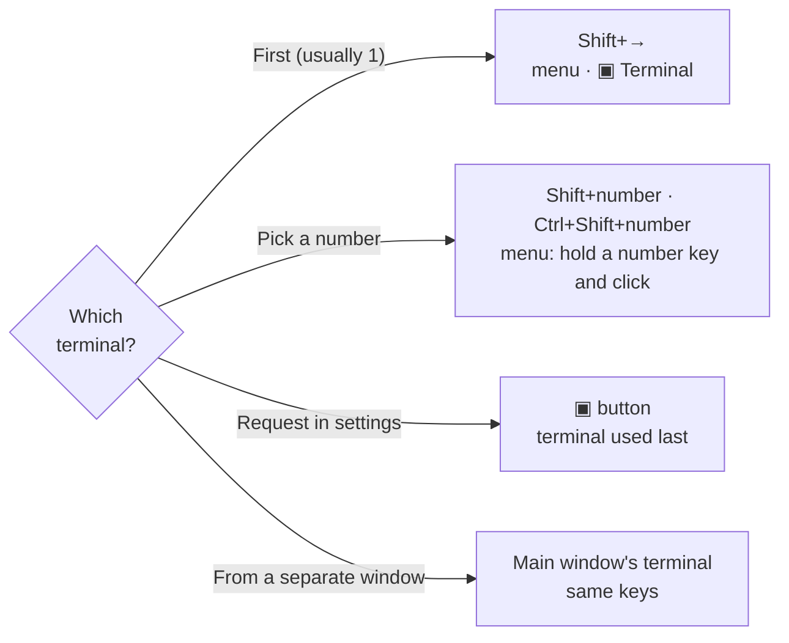

# Sending and requests

> Put a document's location and text into the AI tool in the terminal without pressing Enter, then type your request after it. Keys and menus choose which terminal it goes to.

## At a glance

| To do | Mouse | Keys |
|---|---|---|
| Put the location of the current line or picked lines into the first terminal — focus moves to the terminal too | Right-click inside picked lines or a section focus, **Send to Claude** | **Shift+→** |
| Add several places one after another — focus stays in the document | — | **Ctrl+Shift+→** |
| Put it into the terminal with that number | Open the menu, then hold a number key (1–5) while clicking | **Shift+1–5** · **Ctrl+Shift+1–5** |
| Copy the location | Right-click the text, **Copy location** | **Shift+←** |
| Copy the source | Right-click copy items | **Ctrl+C** (the text selected by dragging, if any) |
| The path of one document | Right-click in the tree, **Copy @path** | — |
| Put the text you would copy straight into the terminal | **▣ Terminal** on the right of a copy item | — |

Menu names follow **AI tool** in the settings window — 'Send to Codex', or 'Send to AI' with several. When you copy, 'Copied: …' shows briefly at the bottom of the screen.

## What is sent

Lines are counted as lines of the source file — a paragraph, list item, heading or table row written on one line counts as one line, while a paragraph split over several lines and code count line by line. So the location sent matches what you picked on screen.

| Where | What is sent |
|---|---|
| Document · code | `@docs/report.md lines 40-52` (`line 12` for one line) |
| Excel sheet — focus rows and press **Shift+→** | `@data/prices.xlsx sheet 'Q1' line 3` |
| An item in Elements · Clip | `@doc lines 12-17 ('caption')` |
| A document in the tree | `@path` |

| Situation | What happens |
|---|---|
| While words are selected | **Shift+→** does not send but widens the selection — release it with **Esc**, then press (**Ctrl+Shift+→** sends even with words selected) |
| Inside a line edit box | Close the box with **Enter** (or **Esc**), then **Shift+→** |
| **Shift+number** in a box or in the terminal | Just a character (! @ # …) |
| Right-clicking alone | Sends nothing — sending happens only when you click a menu item |

## Which terminal it goes to

| Situation | What happens |
|---|---|
| The first terminal | The lowest number — usually terminal 1, the one opened first. If it is closed, it opens and is shown, so run your AI tool in terminal 1 |
| After it goes in | A 'Put into terminal 1' notice. With stacked terminals, the header of the terminal that got it lights up briefly |
| Holding a number key in a menu | '→ terminal 3' shows above the menu — clicking **▣ Terminal** or **Send to Claude** sends to that number |
| **▣** in the settings window | The terminal you used last (the one you clicked or focused) — if your AI tool runs in a terminal other than 1, click that terminal once before opening the settings window. Hold a number key while clicking to send to that number; the number shows on the buttons while you hold it (with the focus in a text box, the digit goes into the box) |
| A number that does not exist | Nothing goes in and you are told — no terminal is created |
| Separate window | **Send to Claude** · **▣ Terminal** · **Send to new note** go to the main window's terminal and notes, and the main window comes to the front. **Shift+→** puts it in while you stay in the separate window, and **Shift+number** or number + click in a menu goes to that terminal of the main window |
| A view-only project (the samples) | No terminal opens, so requests do not go in — copy it to your own folder and do it there |

## Paste into the terminal

**▣ Terminal** on the right of a copy item puts the same text into the terminal (clicking the item name only copies). It is there for selected text, locations, source, code, `@path`, the full path and more, and in the right-click menus of the tree and the 'Code' and 'Other files' lists too.

| Situation | What happens |
|---|---|
| Enter | Not pressed — check the text and press it yourself |
| Several lines at a PowerShell prompt | Lectern asks first — each line might run as a command |
| Several lines in an AI tool (Claude Code · Codex · Antigravity · OpenCode) | Not asked — paste mode keeps them in the input box without sending (**▣ Terminal** and **Ctrl+V** alike) |
| Punctuation | The middle dot (·), em dash (—) and ellipsis (…) go in as they are |

## Requests in menus

What rules cannot do is handed over as a request. A request goes into the terminal without Enter, so add what you want at the end or rewrite it, then press Enter.

| Where | Item | What it does |
|---|---|---|
| 'For this line' in the Change window (**.**) | **Ask to rewrite** | Changes that need rewriting, such as 'these three paragraphs as a table' or 'spell the table out as text'. It asks to keep the content and numbers and to show the new form before editing — write after 'New form:' at the end |
| Right-click a line · picked lines | **Ask Claude for a box** | Sums up the conversation so far as a box after that block |
| Right-click a document's margin | **Ask for a polish check** · **Send as a style sample** | [Writing styles and polish](7.4-writing-styles-and-polish.en.md) |
| Right-click a WORK.md's margin | **Ask to fold in the planning notes** | [Work management](8-work-management.en.md#planning-notes) |
| Right-click a md document in the sidebar | **Ask to make Lectern slides** | As a new file in the same folder |
| Right-click an overflowing slide cell | **Ask to shorten this cell** | The app does not shorten it on its own |
| Clip in the sidebar | **Ask Claude** | A new document from the locations of the clips |
| md document style window | **Headings, and ask Claude about the body** · **Ask Claude for a style** | Changing the document type · picking up a numbering style |
| Template gallery | **Ask Claude for a template** | Add the look you want |
| Convert to html window | **Ask Claude to arrange** | Places the slides to follow the story |

## Requests in the settings window

Each item in the settings window (**Ctrl+,**) has **Copy request for Claude Code** and a **▣** next to it. The request gives the location of a guide that comes with Lectern, and the AI tool reads that guide and does the work.

| Item | What the request hands over |
|---|---|
| Teach Claude Code about Lectern — **All folders (personal)** (default) | Reads the writing guide and sums up the format rules for documents that read well in Lectern in one personal rule file, `~/.claude/rules/lectern.md` |
| Teach Claude Code about Lectern — **Only this folder** | Writes in that project's `CLAUDE.md` who reads that folder's writing and what for |
| PowerPoint and Word skills | Installs only what is missing or different — [Skills](7.3-skills.en.md) |
| Writing style · My voice | [Writing styles and polish](7.4-writing-styles-and-polish.en.md) |
| My styles · Page layouts | Reads the guide and makes a file with the look you want — add the look you want at the end |

Put it in all folders once, and send it again with Only this folder just for folders whose readers are clear. Other tools' files are in [Working with AI tools](7-working-with-ai-tools.en.md#what-differs-by-tool).

## Editing alongside AI tools

While an AI tool edits the same document, your changes and the AI tool's changes do not overwrite each other.

| Situation | What happens |
|---|---|
| Text you were typing in a box | Not lost even if the file changes meanwhile. If lines were added above so only the line number moved, Lectern finds the same line and saves there. If that line itself changed, or the same line appears more than once, it is not saved and your edited line is copied to the clipboard |
| Picked lines | Follow their text. If that text changes or disappears, the lines are released — so another line is never deleted |
| **Ctrl+Z** | If the file changed meanwhile, it does not undo and tells you — so it does not overwrite someone else's changes |
| The screen | Redrawn within a second, and your reading position stays. Changed places: **F7** · **Shift+F7** |

## Related

| Document | What |
|---|---|
| [Terminal](7.1-terminal.en.md) | Several terminals · stacking · position |
| [Current line and picking](3.1-current-line-and-picking.en.md) | Keys to pick the lines to send |
| [Find and search](3.2-find-and-search.en.md) | Going through the places an AI tool changed |
| [Separate windows](2.7-separate-windows.en.md) | Sending from a separate window to the main window |
