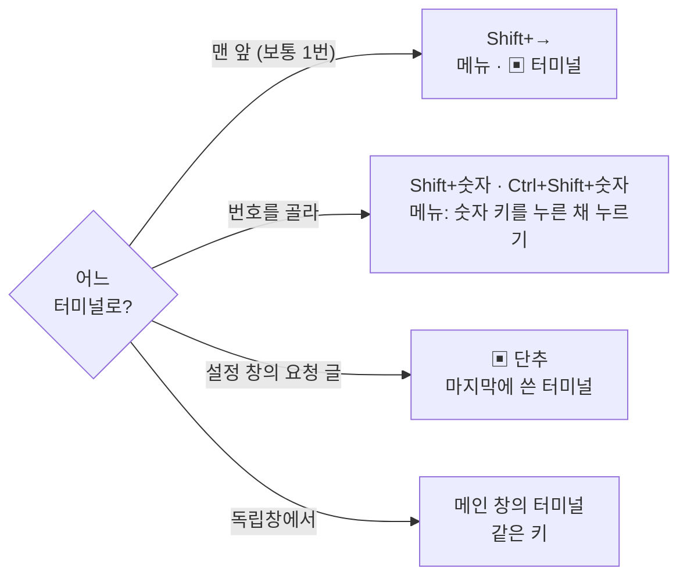

# 보내기와 요청 글

> 문서의 위치와 글을 터미널의 AI 도구에 Enter 없이 넣고, 그 뒤에 요청을 이어 적는다. 어느 터미널로 갈지는 키와 메뉴로 고른다.

## 한눈에

| 하려는 일 | 마우스 | 키 |
|---|---|---|
| 현재 줄·고른 줄의 위치를 최근에 쓴 터미널에 — 초점도 터미널로 | 고른 줄·하이라이트 안에서 우클릭 **Claude로 보내기** | **Shift+→** |
| 여러 곳을 이어서 넣기 — 초점은 문서에 | — | **Ctrl+Shift+→** |
| 그 번호의 터미널에 넣기 | 메뉴를 연 뒤 숫자 키(1~5)를 누른 채 누르기 | **Shift+1~5** · **Ctrl+Shift+1~5** |
| 위치 복사 | 본문 우클릭 **위치 복사** | **Shift+←** |
| 원문 복사 | 우클릭 복사 | **Ctrl+C** (끌어 고른 글이 있으면 그 글) |
| 문서 하나의 경로 | 트리 우클릭 **@경로 복사** | — |
| 복사할 글을 터미널에 바로 | 복사 항목 오른쪽의 **▣ 터미널** | — |

메뉴 이름은 설정 창 **쓰는 AI 도구**를 따른다 — 'Codex로 보내기', 여럿이면 'AI로 보내기'. 복사하면 화면 아래에 '복사했습니다: …' 가 잠시 뜬다.

## 보내는 것

줄은 원문 파일의 줄로 센다 — 한 줄로 쓴 문단·목록 항목·제목·표의 행은 통째로 한 줄, 여러 줄로 나눠 쓴 문단과 코드는 줄마다. 그래서 보낸 위치가 화면에서 고른 곳과 같다.

| 어디서 | 보내는 모양 |
|---|---|
| 문서 · 코드 | `@docs/보고서.md 40~52행` (한 줄이면 `12행`) |
| 엑셀 시트 — 행을 하이라이트하고 **Shift+→** | `@data/가격.xlsx '1분기' 시트 3행` |
| 모아 보기 · 담기의 항목 | `@문서 12~17행 ('캡션')` |
| 트리의 문서 | `@경로` |

| 상황 | 동작 |
|---|---|
| 낱말을 고른 동안 | **Shift+→** 는 보내지 않고 낱말 넓히기 — **Esc** 로 풀고 누른다 (**Ctrl+Shift+→** 는 낱말을 고른 채여도 보낸다) |
| 한 줄 편집 칸 안 | **Enter**(또는 **Esc**)로 칸을 닫고 **Shift+→** |
| 칸 안 · 터미널 안의 **Shift+숫자** | 그냥 글자(! @ # …) |
| 우클릭만 하면 | 보내지 않는다 — 메뉴 항목을 눌러야 보낸다 |

## 어느 터미널로 가나

| 상황 | 동작 |
|---|---|
| **Shift+→** · **Ctrl+Shift+→** · **Claude로 보내기** | **최근에 쓴 터미널** 로 — 마지막으로 누르거나 초점이 간 터미널, 터미널 탭·칸 머리줄에서 고른 터미널, 마지막으로 보낸 터미널. AI 도구가 2번에 떠 있으면 2번을 한 번 누른 뒤로는 계속 2번으로 간다. 터미널이 하나거나 아직 없으면 1번 |
| **▣ 터미널** · AI 요청 메뉴 · 그 밖의 요청 글 | 맨 앞 터미널 — 가장 작은 번호, 보통 처음 연 1번. 닫혀 있으면 열고 그 터미널로 바꿔 보인다 |
| 넣고 나면 | '2번 터미널에 넣었습니다' 처럼 몇 번인지 알린다. 쌓아 둔 칸은 넣은 터미널의 머리줄이 잠깐 빛난다 |
| 메뉴에서 숫자 키를 누른 채 | 메뉴 위에 '→ 3번 터미널' — **▣ 터미널** 이나 **Claude로 보내기**를 누르면 그 번호로 |
| 설정 창의 **▣** | 마지막에 쓴 터미널(누르거나 초점이 간 터미널) — AI 도구가 1번이 아닌 터미널에 떠 있으면 그 터미널을 한 번 누른 뒤 설정 창을 연다. 숫자 키를 누른 채 누르면 그 번호로, 누르는 동안 단추에 번호가 뜬다 (글 칸에 초점이 있으면 숫자는 그 칸의 글) |
| 없는 번호 | 넣지 않고 알린다 — 새로 만들지 않는다 |
| 독립창 | **Claude로 보내기** · **▣ 터미널** · **새 메모로 보내기**는 메인 창의 터미널·메모로 가고 메인 창이 앞으로 나온다. **Shift+→** 는 독립창에 머문 채 메인 창의 최근에 쓴 터미널에 넣고, **Shift+숫자**·메뉴의 숫자+누르기는 메인 창의 그 번호 터미널로 |
| 보기만 하는 프로젝트(예제) | 터미널이 열리지 않아 요청 글이 들어가지 않는다 — 내 폴더로 복사해서 한다 |

## 터미널에 붙여 넣기

복사 항목 오른쪽의 **▣ 터미널**은 같은 글을 터미널에 넣는다 (항목 이름 쪽을 누르면 복사만). 고른 글·위치·원문·코드·`@경로`·전체 경로 등에 있고, 트리·'코드'·'자료' 목록의 우클릭 메뉴에도 있다.

| 상황 | 동작 |
|---|---|
| Enter | 누르지 않는다 — 확인하고 직접 누른다 |
| 여러 줄, PowerShell 프롬프트 | 먼저 묻는다 — 줄마다 명령으로 실행될 수 있어서 |
| 여러 줄, AI 도구 (Claude Code · Codex · Antigravity · OpenCode) | 묻지 않는다 — 붙여넣기 모드라 보내지 않고 입력 칸에 그대로 (**▣ 터미널** · **Ctrl+V** 모두) |
| 부호 | 가운뎃점(·) · 줄표(—) · 말줄임(…) 도 그대로 들어간다 |

## 메뉴의 요청 글

규칙으로 할 수 없는 일은 요청 글로 맡긴다. 요청 글은 터미널에 Enter 없이 들어가니, 끝에 원하는 것을 이어 적거나 고쳐 쓴 뒤 Enter 를 누른다.

| 어디서 | 항목 | 하는 일 |
|---|---|---|
| 바꾸기 창(**.**)의 '이 줄에 맞는 것' | **바꿔 쓰기 요청** | '이 문단 셋을 표로', '표를 글로 풀어' 처럼 다시 써야 하는 바꾸기. 내용과 숫자는 그대로, 고치기 전에 바꾼 모양을 먼저 보이라는 요청 — 끝의 '바꿀 모양:' 뒤에 적는다 |
| 줄 · 고른 줄 우클릭 | **Claude 에 박스글 요청** | 지금까지의 대화를 정리해 그 블록 뒤에 박스글로 |
| 문서 여백 우클릭 | **다듬기 점검 요청** · **내 문체 견본으로 보내기** | [글쓰기 스타일과 다듬기](7.4-글쓰기-스타일과-다듬기.md) |
| WORK.md 여백 우클릭 | **기획 메모 반영 요청** | [업무 관리](8-업무-관리.md#기획-메모) |
| 사이드바의 md 문서 우클릭 | **Lectern 슬라이드로 바꾸기 요청** | 같은 폴더에 새 파일로 |
| 넘친 슬라이드 칸 우클릭 | **이 칸 줄이기 요청** | 앱은 저절로 줄이지 않는다 |
| 사이드바 담기 | **Claude 에 맡기기** | 담은 것들의 위치를 묶어 새 문서로 |
| md 문서 스타일 창 | **머리글을 바꾸고 본문은 Claude 에게 요청** · **Claude 에게 스타일 요청** | 문서 방식 바꾸기 · 번호 모양 뽑기 |
| 템플릿 갤러리 | **Claude 에게 템플릿 요청** | 원하는 모양을 이어 적는다 |
| html 로 전환 창 | **Claude 에게 배치 요청** | 이야기 흐름에 맞게 장의 자리를 |

## 설정 창의 요청 글

설정 창(**Ctrl+,**)의 항목마다 **Claude Code용 요청 복사**와 옆의 **▣** 가 있다. 요청 글은 Lectern 에 든 안내의 위치를 알려 주고, AI 도구가 그 안내를 읽고 일한다.

| 항목 | 요청 글이 맡기는 일 |
|---|---|
| Claude Code 에 Lectern 알려 주기 — **모든 폴더(개인)** (기본) | 작성 안내를 읽고, 개인 규칙 파일 `~/.claude/rules/lectern.md` 하나에 Lectern 에서 잘 보이는 문서의 형식 규칙을 정리한다 |
| Claude Code 에 Lectern 알려 주기 — **이 폴더만** | 그 프로젝트의 `CLAUDE.md` 에 그 폴더의 글을 누가 읽고 무엇에 쓰는지 정리한다 |
| PowerPoint·Word 스킬 | 없는 것과 다른 것만 설치 — [스킬](7.3-스킬.md) |
| 글쓰기 스타일 · 내 문체 | [글쓰기 스타일과 다듬기](7.4-글쓰기-스타일과-다듬기.md) |
| 내 스타일 · 지면 틀 | 설명서를 읽고 원하는 모양의 파일을 만든다 — 원하는 모양을 이어 적는다 |

한 번 모든 폴더에 넣어 두고, 읽는 사람이 뚜렷한 폴더에서만 이 폴더만으로 한 번 더 보낸다. 다른 도구의 파일은 [도구마다 다른 것](7-AI-도구와-함께.md#도구마다-다른-것)에 있다.

## AI 도구와 함께 고칠 때

AI 도구가 같은 문서를 고치는 동안에도 사람이 고친 것과 AI 도구가 고친 것이 서로를 덮지 않는다.

| 상황 | 동작 |
|---|---|
| 칸에 쓰던 글 | 그사이 파일이 바뀌어도 사라지지 않는다. 위쪽에 줄이 더해져 번호만 밀렸으면 같은 줄을 찾아 그 자리에 저장한다. 그 줄 자체가 바뀌었거나 같은 줄이 둘 이상이면 저장하지 않고 고친 줄을 클립보드에 복사해 둔다 |
| 고른 줄 | 글을 따라간다. 그 글이 바뀌거나 없어지면 고르기를 푼다 — 다른 줄을 지우지 않게 |
| **Ctrl+Z** | 그사이 파일이 바뀌었으면 되돌리지 않고 알린다 — 남이 고친 것을 덮어쓰지 않게 |
| 화면 | 1초 안에 다시 그려지고 보던 자리는 그대로. 바뀐 곳은 **F7** · **Shift+F7** |

## 관련

| 문서 | 무엇 |
|---|---|
| [터미널](7.1-터미널.md) | 여러 터미널 · 쌓기 · 자리 |
| [현재 줄과 고르기](3.1-현재-줄과-고르기.md) | 보낼 줄을 고르는 키 |
| [찾기와 검색](3.2-찾기와-검색.md) | AI 도구가 고친 곳을 차례로 보기 |
| [따로 창](2.7-따로-창.md) | 독립창에서 메인 창으로 보내기 |
